# Notification Trigger Tree

## Current Architecture

```mermaid
graph TD
    A[Notification Triggers] --> B[Admin Broadcast]
    A --> C[Match Cancelled]
    A --> D[Presence Reminder]
    A --> E[Ride Cancelled]
    A --> F[Manual Points Adjustment]

    B --> B1[Recipients: All users in division]
    B --> B2[Recipients: All users in team's division]
    B --> B3[Recipients: All users if no division]
    B --> B4[Channel: Push + In-app]
    B --> B5[Options: Recurring, Startup, Expiry]

    C --> C1[Recipients: Staff & Volunteers who signed up for the match]
    C --> C2[Channel: Push + In-app]
    C --> C3[Title: Match annulé]

    D --> D1[Recipients: Users in families with pending child registrations]
    D --> D2[Channel: Push + In-app]
    D --> D3[Title: Confirmez votre présence]
    D --> D4[Frequency: Every 15 minutes]
    D --> D5[Dedup: reminder_logs table]

    E --> E1[Recipients: Passengers who booked the ride]
    E --> E2[Channel: Push + In-app]
    E --> E3[Title: Covoiturage annulé]

    F --> F1[Recipients: The person receiving points/penalty]
    F --> F2[Channel: Push + In-app]
    F --> F3[Title: Pénalité or Bonus]
    F --> F4[Trigger: Admin creates penalty/bonus via points history]

    style A fill:#f9f,stroke:#333,stroke-width:2px
    style B fill:#bbf,stroke:#333
    style C fill:#bbf,stroke:#333
    style D fill:#bbf,stroke:#333
    style E fill:#bbf,stroke:#333
    style F fill:#bbf,stroke:#333
```



## Detailed Trigger Paths

### 1. Admin Broadcast
```
Admin clicks "Envoyer la notification"
  → POST /api/v1/admin/notifications
    → GetUserIdsByDivisionAsync(divisionId)
      → If divisionId is null: all active users
      → If divisionId is set: users in families with children in that division
    → SendToUsersAsync(recipients, title, body, data, expiresAtUtc, recurring, startup)
      → Create UserNotification for each recipient
      → Push via FCM (best-effort)
```

### 2. Match Cancelled
```
Match is cancelled (MatchCancelled event)
  → MatchCancelledHandler.HandleAsync
    → Get staff & volunteers who signed up for the match
    → SendToUsersAsync(staffAndVolunteers, "Match annulé", body, data)
      → Create UserNotification for each recipient
      → Push via FCM (best-effort)
```

### 3. Presence Reminder (Background Service)
```
Every 15 minutes (PresenceReminderService)
  → Get matches starting within 4 days
  → For each match, find families with pending child registrations
  → For each pending family:
    → Check if reminder already sent (reminder_logs)
    → Get users from the family
    → SendToUsersAsync(userIds, "Confirmez votre présence", body, data)
      → Create UserNotification for each recipient
      → Push via FCM (best-effort)
    → Log reminder in reminder_logs
```

### 4. Ride Cancelled
```
Driver cancels a ride
  → POST /api/v1/carpool/rides/{id} (cancel)
    → Get passengers who booked the ride
    → SendToUsersAsync(passengers, "Covoiturage annulé", body, data)
      → Create UserNotification for each recipient
      → Push via FCM (best-effort)
```

### 5. Manual Points Adjustment (Penalty/Bonus)
```
Admin creates penalty/bonus via points history
  → POST /api/v1/admin/penalties
    → AddManualAsync (creates PointEntry)
    → SendToPersonAsync(personId, "Pénalité" or "Bonus", body, data)
      → Create UserNotification for the person
      → Push via FCM (best-effort)
```

## Proposed New Architecture

```mermaid
graph TD
    A[Notification Triggers] --> B[Admin Broadcast]
    A --> C[Match Cancelled]
    A --> D[Presence Reminder]
    A --> E[Ride Cancelled]
    A --> F[Manual Points Adjustment]
    A --> G[Slot Filled/Unfilled]
    A --> H[Match Scheduled]
    A --> I[Ranking Milestone]

    B --> B1[Recipients: All / Division / Team / Role]
    B --> B2[Channel: Push + In-app]
    B --> B3[Options: Recurring, Startup, Expiry, Priority]

    C --> C1[Recipients: Staff & Volunteers + Families with children registered]
    C --> C2[Channel: Push + In-app]
    C --> C3[Priority: High]

    D --> D1[Recipients: Users in families with pending child registrations]
    D --> D2[Channel: Push + In-app]
    D --> D3[Frequency: Every 15 minutes]
    D --> D4[Dedup: reminder_logs table]

    E --> E1[Recipients: Passengers who booked the ride]
    E --> E2[Channel: Push + In-app]
    E --> E3[Priority: Medium]

    F --> F1[Recipients: The person receiving points/penalty]
    F --> F2[Channel: Push + In-app]
    F --> F3[Priority: Low]

    G --> G1[Recipients: Admin + Match organizer]
    G --> G2[Channel: Push + In-app]
    G --> G3[Trigger: When a slot becomes full or empty]

    H --> H1[Recipients: Division members + Staff]
    H --> H2[Channel: Push + In-app]
    H --> H3[Trigger: When a match is scheduled]

    I --> I1[Recipients: The family/person achieving milestone]
    I --> I2[Channel: Push + In-app]
    I --> I3[Trigger: When points cross a threshold]

    style A fill:#f9f,stroke:#333,stroke-width:2px
    style B fill:#bbf,stroke:#333
    style C fill:#bbf,stroke:#333
    style D fill:#bbf,stroke:#333
    style E fill:#bbf,stroke:#333
    style F fill:#bbf,stroke:#333
    style G fill:#bfb,stroke:#333
    style H fill:#bfb,stroke:#333
    style I fill:#bfb,stroke:#333
```



## New Trigger Paths

### 6. Slot Filled/Unfilled (NEW)
```
Slot capacity changes (SlotJoined/SlotLeft event)
  → Check if slot is now full or empty
  → If full: notify admin + match organizer
  → If empty (was full): notify admin + match organizer
  → SendToUsersAsync(admins, "Poste pourvu/libéré", body, data)
    → Create UserNotification for each recipient
    → Push via FCM (best-effort)
```

### 7. Match Scheduled (NEW)
```
Match is created/scheduled
  → MatchScheduled event
    → Get division members + staff
    → SendToUsersAsync(recipients, "Nouveau match", body, data)
      → Create UserNotification for each recipient
      → Push via FCM (best-effort)
```

### 8. Ranking Milestone (NEW)
```
Points are awarded (PointsAwarded event)
  → Check if family/person crosses a milestone threshold
  → If milestone reached: notify the family/person
  → SendToPersonAsync(personId, "Félicitations !", body, data)
    → Create UserNotification for the person
    → Push via FCM (best-effort)
```

## Recipient Resolution Matrix

| Trigger | Recipients | Channel | Priority |
|---------|-----------|---------|----------|
| Admin Broadcast | All / Division / Team / Role | Push + In-app | Normal |
| Match Cancelled | Staff & Volunteers + Families | Push + In-app | High |
| Presence Reminder | Families with pending registrations | Push + In-app | Normal |
| Ride Cancelled | Passengers | Push + In-app | Medium |
| Points Adjustment | The person receiving points | Push + In-app | Low |
| Slot Filled/Unfilled | Admin + Match organizer | Push + In-app | Low |
| Match Scheduled | Division members + Staff | Push + In-app | Normal |
| Ranking Milestone | Family/Person achieving milestone | Push + In-app | Low |

## Implementation Notes

### Current Gaps
1. ~~MatchCancelledHandler skips family notifications~~ - fixed (see `notification-candidates.md`, "État d'implémentation")
2. **Slot Filled/Unfilled** - slot created/updated/deleted and late withdrawal are done; "full / unfilled" admin info is not
3. ~~No Match Scheduled notifications~~ - done (`MatchCreated` event + handler)
4. **No Ranking Milestone notifications** - would need to track point thresholds
5. **No email** - by decision, the app sends no email except account-security messages (password changed, new-device login, sessions revoked, email changed, password reset). Every other notification is Push + In-app only; the fallback for users without a push token is the in-app list.
6. **Team-based targeting** - still resolves to division. Players now belong to teams per season (`team_memberships`, several teams per player), so `GetUserIdsByTeamAsync` can be built on them.

### Recommended Next Steps
1. Add `IIdentityApi.GetUserIdsByTeamAsync` for proper team-based targeting
2. Implement SlotFilled/SlotUnfilled event handlers
3. Add MatchCreated event and handler
4. Add point threshold tracking for ranking milestones
5. Implement a minimal email sender restricted to account-security messages (SendGrid/SMTP); no email for any other notification type

See `notification-candidates.md` for the extra triggers, the consolidated table (priority, key, type, recipients, channels) and the "no email except security" decision.
6. Add notification preferences per user (opt-in/opt-out by type)